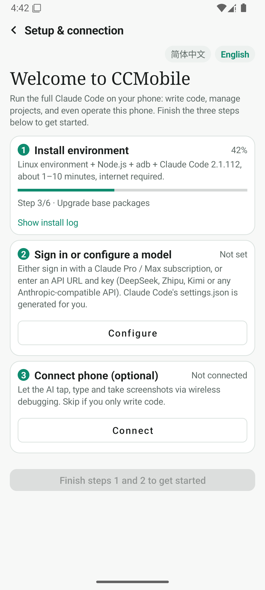
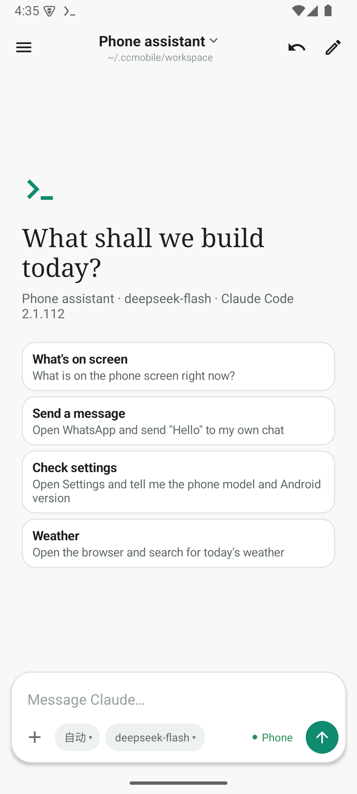

# CCMobile

**在安卓手机上运行完整的 Claude Code。** 内置 Linux 环境，一键安装，提供原生对话界面，还能通过无障碍服务让 AI 直接操作这台手机。

**Run the full Claude Code on your Android phone.** Built-in Linux environment, one-tap setup, a native chat UI, and phone control via an accessibility service. [English below](#english)

> ⚠️ 非官方社区项目，与 Anthropic 无关，未获其认可或赞助。Claude、Claude Code 是 Anthropic 的商标。
> 本应用不包含、也不分发 Claude Code：它由用户在安装时从 npm 下载，使用受 [Anthropic 条款](https://www.anthropic.com/legal) 约束。

<p>


</p>

## 功能

- **一键安装**：首次打开自动安装 Linux 环境、Node.js、adb 和 Claude Code，带进度条与日志；镜像源失败时自动换下一个。
- **两种登录方式**：Claude Pro / Max 订阅账号登录；或任意 Anthropic 兼容 API（DeepSeek、智谱、Kimi 等），自动生成 `~/.claude/settings.json`。
- **类桌面端的对话界面**：项目与文件夹（可移除或彻底删除）、历史会话、流式输出、可折叠的思考过程、工具调用卡片（命令、差异对比、待办清单）、图片附件、撤销上一轮、删除与恢复会话。
- **完整交互**：Claude Code 的选择题、权限确认、计划审批都有对应卡片（基于官方 SDK 控制协议）。
- **手机操控**：开启「CCMobile 手机控制」无障碍服务即可，MCP 工具读屏（压缩为编号列表以节省 token）、点击、中文输入（不切换键盘）、滑动、截图（Android 11+）；后台运行时有悬浮窗显示进度，并可在悬浮窗里继续委派下一步任务（进行中则排队）。
- **安全设计**：无障碍接口只接受本 App 的进程调用，不开放网络端口；银行、支付等敏感应用中不读取也不操作；点击「支付 / 转账 / 删除」等按钮前弹框请用户确认（由服务强制，AI 无法绕过）。无线调试（adb）作为高级模式默认关闭，需两次确认才能开启、24 小时自动关闭，且拒绝修改分辨率 / DPI、恢复出厂等危险命令。
- **Claude Code 版本**：默认最新版（官方原生程序经内置 musl 加载器运行，自动更新，第三方模型也支持自动模式）；装不上时自动回退兼容版 2.1.112（Node 运行，此时自动模式改为完全放行），并在后台重试。
- **文件访问**：安装时提前申请存储权限并建立 `~/storage`（等同 `termux-setup-storage`），AI 生成的文件可直接在手机上打开。
- **终端**：保留完整 Termux 终端，可从当前会话直接打开交互式 Claude Code，带翻页按钮。
- **中文 / English**：首次启动跟随系统语言，可在设置中切换。

## 安装

1. 从 [Releases](../../releases) 下载对应架构的 APK（大多数手机选 `arm64-v8a`）。电脑上的安卓模拟器（MuMu、雷电、Android Studio 等）请选 `x86_64` 或 `universal`；模拟器上最新版 Claude Code 无法运行（安卓对 x86_64 应用的系统调用限制），会自动使用兼容版 2.1.112。
2. **先卸载官方 Termux**：本应用包名同为 `com.termux`（Termux 预编译程序写死了该路径），二者不能共存。
3. 打开 App，按引导完成：安装环境 → 登录或填写 API → 开启手机控制（可选，系统设置 → 无障碍 → CCMobile 手机控制）。

Android 13+ 若无障碍开关是灰色：应用信息 → 右上角菜单 →「允许受限设置」。

## 从源码构建

需要 JDK 17+、Android SDK（compileSdk 36）和 NDK（`gradle.properties` 中的 `ndkVersion`，或在 `local.properties` 用 `ccm.ndk.dir` 指定其他 NDK 路径）。

```bash
./gradlew assembleDebug                                       # 调试包（Termux 公开测试密钥签名）
TERMUX_SPLIT_APKS_FOR_RELEASE_BUILDS=1 ./gradlew assembleRelease  # 发布包（按架构拆分）
```

发布签名：在仓库根目录创建 `keystore.properties`（已被 git 忽略）：

```properties
storeFile=/path/to/your-release.jks
storePassword=...
keyAlias=...
keyPassword=...
```

国内网络可通过代理构建：`./gradlew assembleDebug -Dhttps.proxyHost=127.0.0.1 -Dhttps.proxyPort=7890`。

## 代码结构

| 位置 | 作用 |
|---|---|
| `app/src/main/java/com/termux/ccm/` | CCMobile 新增代码：界面、配置、无障碍服务、配对、输入法、悬浮窗、控制协议等 |
| `app/src/main/assets/ccmobile/` | 安装与运行脚本（`setup.sh`、`bin/ccm*`）、手机控制 MCP（`phone_mcp.js`）、musl 加载器、翻译（`i18n/`） |
| `app/src/main/res/**/ccm_*` | 设计系统（配色、图标、样式）与界面文字 |
| 其余 | 上游 [Termux](https://github.com/termux/termux-app) 代码，少量改动见 [NOTICE.md](NOTICE.md) |

添加语言：在 `assets/ccmobile/i18n/` 新增 `<语言>.json`（中文原文 → 译文），并补充 `res/values-<语言>/ccm_strings.xml`。

## 许可证

[GPLv3](LICENSE.md)。本项目基于 [Termux](https://github.com/termux/termux-app)（GPLv3）修改；第三方组件及修改说明见 [NOTICE.md](NOTICE.md)。

---

## English

CCMobile runs the full **Claude Code** on Android: a built-in Linux environment (a Termux fork), one-tap setup, a desktop-style chat UI, and phone control through an accessibility service.

> ⚠️ Unofficial community project — not affiliated with, endorsed or sponsored by Anthropic. Claude and Claude Code are trademarks of Anthropic. This app does not include or distribute Claude Code; it is downloaded from npm by the user during setup and is subject to [Anthropic's terms](https://www.anthropic.com/legal).

**Features**
- One-tap setup of Linux, Node.js, adb and Claude Code with progress and logs.
- Sign in with a **Claude Pro / Max subscription**, or use any Anthropic-compatible API (DeepSeek, Zhipu, Kimi…); `~/.claude/settings.json` is generated for you.
- Desktop-style chat: projects and folders (remove or delete permanently), session history, streaming, collapsible thinking, tool cards (commands, diffs, todos), image attachments, undo last turn, delete/restore sessions.
- Full interactivity: multiple-choice questions, permission prompts and plan approval via the official SDK control protocol.
- Phone control: turn on the "CCMobile phone control" accessibility service; MCP tools read the screen (compressed into a numbered list to save tokens), tap, type (incl. CJK, without switching keyboards), swipe and screenshot (Android 11+); a floating bubble shows progress in the background and lets you delegate the next task (queued while one is running).
- Safety: the accessibility interface only accepts calls from this app and opens no network ports; banking/payment apps are never read or operated; tapping Pay / Transfer / Delete-style buttons requires on-screen user confirmation enforced by the service. Wireless debugging (adb) is an advanced mode, off by default, enabled only after two confirmations, auto-disabled after 24 hours, and refuses dangerous commands such as changing resolution/DPI or factory reset.
- Claude Code: **Latest** by default (the official native build runs through a bundled musl loader, auto-updates, and supports auto mode with third-party models); falls back to **2.1.112** (Node; auto mode becomes bypass) if Latest can't be installed, retrying in the background.
- Storage access is requested during setup and `~/storage` is linked (like `termux-setup-storage`), so generated files can be opened on the phone.
- Full Termux terminal; open the current session in interactive Claude Code; page-scroll buttons.
- Chinese / English UI, following the system language on first launch.

**Install**: download the APK for your architecture from [Releases](../../releases) (`arm64-v8a` for most phones; `x86_64` or `universal` for PC emulators such as MuMu or Android Studio, where Latest can't run and 2.1.112 is used). Uninstall the official Termux first — CCMobile keeps the `com.termux` package name (Termux binaries hard-code it), so they can't coexist.

**Build**: see the commands above. **License**: GPLv3, based on Termux; see [NOTICE.md](NOTICE.md).
